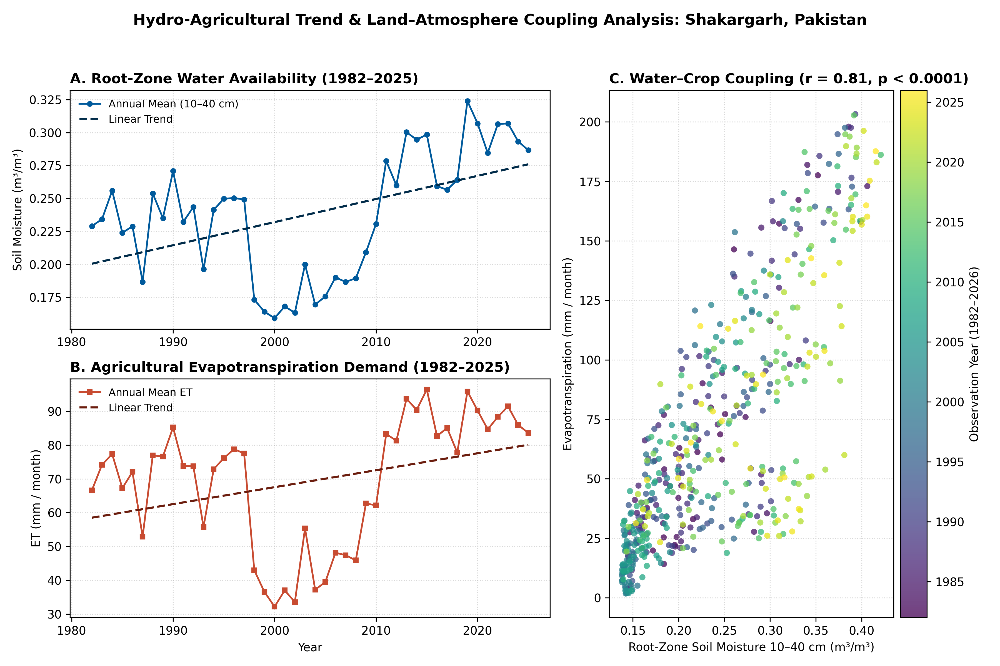
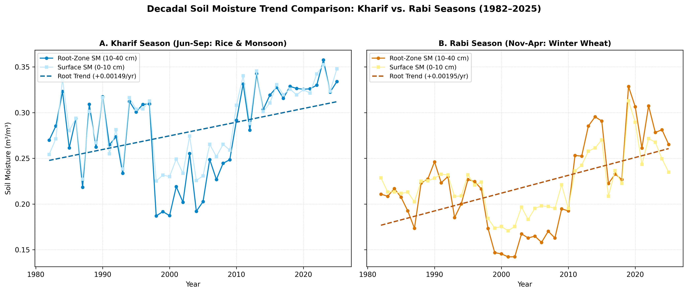
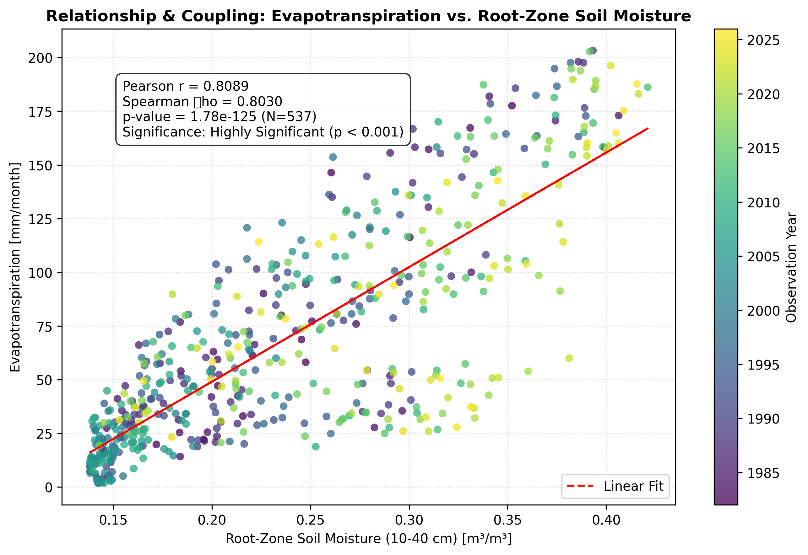

# 🌾 The story of Shakargarh's resources: Crop-Water stress in the past 4 decades

**NASA Space Apps Challenge — *Be An Earth System Trend Detective!***  
🔗 **Live Interactive Observatory:** [Launch Streamlit App]([https://streamlit.app](https://trend-analysis-3ubffzvgv5f78gm6xx4giz.streamlit.app/))
- 📊 **Project Presentation:** [Download PowerPoint (Amina Zafar.pptx)](https://github.com)

---

## 📌 Project Overview
For generations, farming families between the **River Ravi** and **Nullah Bein** in Tehsil Shakargarh (Punjab, Pakistan; `32.0°N–32.5°N, 75.0°E–75.5°E`) have timed their rice (Kharif) and wheat (Rabi) rotations to seasonal water cycles. This project combines **44 years of NASA FLDAS hydrological records (`1982–2025`, `N = 528` months)** with **26 years of 1 km Terra MODIS satellite crop greenness (`2000–2025`)** to uncover how rising atmospheric water demand and shifting soil moisture are reshaping local agricultural resilience.

---

## 🔬 Data & Methodology
* **Hydrological Telemetry (NASA GES DISC Giovanni):** `FLDAS_NOAH01_C_GL_M v001` (`0.1°` monthly, `1982–2025`) — Total Evapotranspiration (`Evap_tavg`), Surface Soil Moisture (`0–10 cm`), and Root-Zone Soil Moisture (`10–40 cm`).
* **Satellite Crop Greenness (NASA AppEEARS):** `MOD13A3.061` (`1 km` monthly NDVI, `2000–2025`) across three representative agro-ecological zones: *Nullah Bein Central*, *Ravi Floodplain South*, and *Northeastern Rainfed*.
* **Statistical Trend Detection:** Autocorrelation-corrected **Hamed–Rao Modified Mann–Kendall Test** and **Sen’s Slope Estimator** ($\alpha = 0.05$).
* **Cross-Sensor Coupling:** Pixel-level and area-averaged Pearson correlation ($r$) linking root-zone water supply to evapotranspiration and canopy greenness.

---

## 📊 Key Scientific Findings
1. **Accelerating Evaporative Demand:** Mean annual evapotranspiration increased by **+18.52%** (`63.43 → 75.18 mm/month`, Sen's slope `+0.45 mm/mo/yr`, **$p \approx 0.01$**), outpacing root-zone soil moisture gains (**+17.95%**, **$p \approx 0.04$**).
2. **Tight Water-Limited Coupling:** Root-zone soil moisture strongly governs crop evapotranspiration (**$r = 0.81, p < 0.0001$**), while spatial correlation maps highlight local hydrological buffering along the **Nullah Bein–River Ravi** irrigation corridor ($r \approx 0.64\text{–}0.80$) compared to strictly water-limited outer farmland ($r > 0.80$).
3. **Seasonal Asymmetry (Two Opposite Risks):**
   * **Kharif (Jun–Sep Monsoon Rice):** Soil moisture rose significantly ($p < 0.05$) without proportional evapotranspiration gains—indicating episodic monsoon waterlogging rather than productive crop water use.
   * **Rabi (Nov–Apr Winter Wheat):** Soil moisture shows no statistically significant gain ($p \approx 0.05\text{–}0.07$), leaving winter wheat vulnerable to dry-season evaporative stress.
   * ---

## 🖼️ Visual Diagnostics

### 1. 44-Year Hydro-Agricultural Trends & Coupling (1982–2025)

### 2. Seasonal Soil Moisture–Evapotranspiration Coupling Curve

### 3. Spatial Land–Atmosphere Coupling Across Shakargarh (NASA Giovanni)

